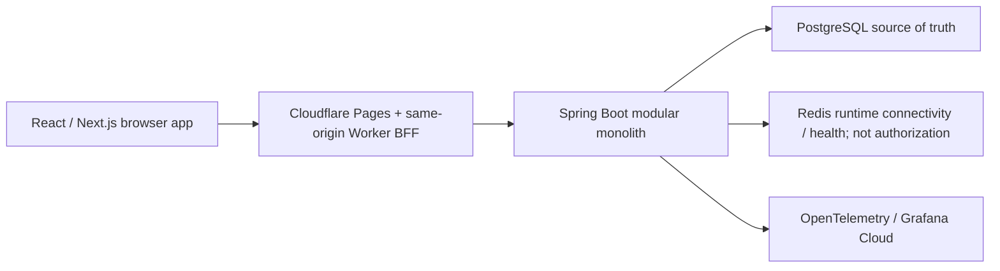

# V-Core architecture

## Runtime



The browser only calls `/api`. In hosted environments the Cloudflare Worker forwards those requests to the configured backend origin. This avoids browser CORS and cookie-domain coupling while retaining the free `pages.dev` frontend URL. Full-stack local development runs the exported site through Wrangler Pages dev, which executes the same BFF contract.

## Backend module boundaries

- `identity`: user identity and authentication adapters.
- `workspace`: memberships, roles, invitations, project/sprint/workflow operations, and tenant boundaries.
- `task`: task commands, queries, workflow moves, assignments, comments, and tags.
- `activity`: immutable audit entries, outbox publishing, and realtime streams.
- `shared`: deliberately small cross-cutting primitives only.

Project creation provisions an active sprint and a four-column workflow in one transaction. Workflow-limit changes use optimistic versions; task assignment and comments reuse the same tenant and idempotency boundaries as board commands.

An optional workflow template ID selects an immutable, workspace-scoped published revision (V7). Publishing validates the complete definition before activation; provisioning copies its ordered columns and provenance in the existing project/sprint/audit/outbox/idempotency transaction. No ID preserves original defaults. New revisions never remap an active project. The existing operations screen gains a synthetic scenario picker and a selected-project workbench; task commands still use the same Java services and actual column IDs. See [customer delivery design](fde/solution-design.md) for API contracts, concurrency and explicit exclusions.

Modules communicate through public application services and domain events. Controllers do not access repositories directly. Persistence entities do not leave the backend boundary.

## Consistency rules

- PostgreSQL owns all durable business state.
- Read/write/admin authorization always queries PostgreSQL. The old Redis membership cache has been removed; Redis connectivity remains configured but is not evidence of an active authorization cache.
- Every write is scoped to a workspace and checked against the authenticated membership.
- Task updates require the version last seen by the client.
- A task move and its WIP-limit check happen in one transaction.
- A business mutation and its outbox record commit in the same transaction.
- Request retries use a client-supplied idempotency key backed by a durable record.

## User identity and public demo

The Worker strips caller email identity headers and forwards only service trust plus same-origin session cookies/CSRF. Spring Security verifies BCrypt accounts stored in PostgreSQL and uses Spring Session JDBC. The PostgreSQL-specific Spring Session customizer upserts concurrent attribute inserts; this avoids duplicate-key failures, not a promise of linearizable session attributes.

An explicitly enabled public demo uses a dedicated workspace VIEWER principal represented as anonymous authentication. It must not be treated as a real login or trigger session/CSRF rotation. Account application roles gate write eligibility, while current workspace memberships determine tenant/member/admin authorization. Login rotates the session ID; disabling an account rejects its next request.

SSE captures the subscribing user and original session ID (or explicit demo identity). A PostgreSQL policy rechecks membership plus an enabled account and unexpired session bound to that user before every event and idle heartbeat. It closes/unregisters on denial or authorization DB failure; idle heartbeats do not refresh session activity. The anonymous demo still requires its own current membership and explicit configuration.

Callbacks unregister completed/disconnected emitters without recursively completing them. Application closure tolerates an already-ended servlet error lifecycle. Only container ASYNC/ERROR redispatch is permitted without another route authorization pass: the initial REQUEST remains protected, and each actual SSE send uses its own policy. This avoids attempting a new 401/403 after stream headers are committed.

Remaining limitations: revocation is checked at dispatch time, not atomically locked through network delivery; idle detection depends on the heartbeat scheduler and DB availability/latency. Each subscriber/event currently incurs a DB authorization query, without a large-fanout performance claim. Permission changes do not undo already authorized transactions or previously delivered bytes. Durable SSE convergence, idempotency retention and cross-actor scope remain separate remediation work.

## Repository layout

```text
app/, components/, hooks/, lib/, store/  Next.js frontend
public/_worker.js                         Cloudflare BFF and static asset worker
backend/                                  Spring Boot modular monolith
docs/                                     Product, architecture, API, and evidence
infra/                                    Docker, Helm, and later Terraform
```

## Quality gates

The verification paths run frontend static analysis, unit tests, production builds and Playwright tests; backend formatting plus Testcontainers integration tests; Flyway migration validation; Dockerfile checks/builds; and Helm lint/render checks. CI uses checked-in lockfiles and wrappers so local and hosted builds resolve the same toolchain.
